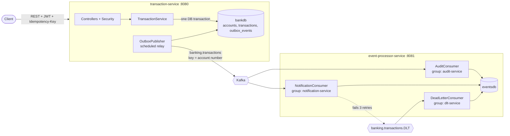

# Banking Transaction Service

An event-driven banking backend built to demonstrate **distributed-systems fundamentals with Java, Spring Boot and Kafka**:
transactional consistency, idempotent APIs, the transactional outbox pattern, retries with a dead-letter topic,
and JWT security. Two independently deployable microservices, each with its own database, talk through Kafka.

**Stack:** Java 17 · Spring Boot 3.3 · Spring Data JPA · PostgreSQL 16 · Flyway · Apache Kafka (KRaft) ·
Spring Security + JWT · Docker Compose · JUnit 5 + Mockito

## Architecture



### Request flow for a transfer

1. `POST /api/transactions/transfer` with a JWT and an `Idempotency-Key` header.
2. In **one database transaction**: insert the transaction row (unique idempotency key) → lock both accounts
   (`SELECT … FOR UPDATE`, in a fixed order) → debit/credit → insert an **outbox event**. Commit, or roll back everything.
3. `OutboxPublisher` polls unpublished outbox rows, publishes them to Kafka (key = account number) and marks them published.
4. Two consumer groups each receive every event: **audit** stores it, **notification** "sends" a message to the affected accounts.
5. If a consumer keeps failing, the record is retried with exponential backoff and finally moved to `banking.transactions.DLT`,
   where a dead-letter consumer stores it with the failure reason.

## Key design decisions

| Concern | Decision | Why |
|---|---|---|
| Consistency | Balance change + transaction row + outbox row in a single DB transaction | No partial transfers; money and event can never disagree |
| Dual-write problem | **Transactional outbox** instead of calling Kafka inside the DB transaction | If Kafka is down or the app crashes after commit, the event is still in the DB and gets published later |
| Duplicate requests | `Idempotency-Key` header, stored in a `UNIQUE` column; request fingerprint stored alongside | Safe client retries. Same key + same body → original result (`200`, `idempotentReplay: true`). Same key + different body → `409`. Concurrent duplicates are serialised by the unique index |
| Concurrent updates | Pessimistic row locks; multi-account locks taken in sorted account-number order | Prevents lost updates and A↔B deadlocks |
| Delivery semantics | At-least-once (outbox → Kafka → consumer) + **idempotent consumers** (unique `event_id`) | "Exactly-once effect" without distributed transactions |
| Ordering | Kafka message key = account number | Events for one account stay in order within a partition |
| Failures | `DefaultErrorHandler`: 3 retries (1s/2s/4s), non-retryable for malformed payloads, then `<topic>.DLT` | A poison message never blocks a partition |
| Independent consumers | Separate consumer groups for audit / notification | Each gets every event; one failing doesn't affect the other |
| Data ownership | Database-per-service (`bankdb`, `eventsdb`); services share only the event contract | Loose coupling; consumer is a tolerant reader (ignores unknown fields) |
| Security | Stateless JWT (HS256), BCrypt passwords, users can only touch their own accounts | |
| Errors | `@RestControllerAdvice` returning RFC 7807 `application/problem+json` | Consistent error shape |
| Schema | Flyway migrations, `ddl-auto: validate` | Versioned, reviewable schema |

## Run it

Prerequisite: Docker (with Compose v2).

```bash
docker compose up --build
```

First start takes a few minutes (Maven build). When it settles:

* transaction-service → http://localhost:8080 (health: `/actuator/health`)
* event-processor-service → http://localhost:8081

Run the scripted end-to-end demo (needs only `curl`):

```bash
bash scripts/demo.sh
```

> If you ever recreate containers and the `eventsdb` database is missing, run `docker compose down -v` once to reset the volume.

### Manual walkthrough

```bash
# 1. Register and log in
curl -X POST localhost:8080/api/auth/register -H 'Content-Type: application/json' \
  -d '{"username":"alice","password":"Password123!"}'
TOKEN=$(curl -s -X POST localhost:8080/api/auth/login -H 'Content-Type: application/json' \
  -d '{"username":"alice","password":"Password123!"}' | grep -o '"accessToken":"[^"]*"' | cut -d'"' -f4)

# 2. Create an account
curl -X POST localhost:8080/api/accounts -H "Authorization: Bearer $TOKEN" \
  -H 'Content-Type: application/json' -d '{"holderName":"Alice"}'

# 3. Deposit (note the Idempotency-Key)
curl -X POST localhost:8080/api/transactions/deposit -H "Authorization: Bearer $TOKEN" \
  -H 'Content-Type: application/json' -H 'Idempotency-Key: dep-001' \
  -d '{"accountNumber":"<your-account-number>","amount":250.00}'

# Repeat the exact same command: 200 OK with "idempotentReplay": true, balance unchanged.
```

### Watch the Kafka flow

```bash
# See the events on the topic
docker exec -it bank-kafka /opt/kafka/bin/kafka-console-consumer.sh \
  --bootstrap-server localhost:9092 --topic banking.transactions --from-beginning

# See what the consumers stored
curl localhost:8081/internal/audit-logs
curl localhost:8081/internal/notifications
curl localhost:8081/internal/dead-letters
```

### Trigger the retry + dead-letter path

The notification consumer has a demo failure switch: a transaction whose amount is exactly **666.66** makes it throw.
Deposit 666.66 and watch the `event-processor` logs: three retries (≈1s, 2s, 4s), then the record lands on
`banking.transactions.DLT` and appears at `/internal/dead-letters`. The **audit** consumer still processes the same
event normally, because it is a separate consumer group.

## API

| Method | Path | Auth | Notes |
|---|---|---|---|
| POST | `/api/auth/register` | – | `{username, password}` |
| POST | `/api/auth/login` | – | returns `{accessToken, tokenType, expiresInSeconds}` |
| POST | `/api/accounts` | JWT | `{holderName}` → 12-digit account number |
| GET | `/api/accounts` | JWT | your accounts |
| GET | `/api/accounts/{no}` | JWT | balance (owner only) |
| GET | `/api/accounts/{no}/transactions?page=&size=` | JWT | paged history |
| POST | `/api/transactions/deposit` | JWT + `Idempotency-Key` | `{accountNumber, amount}` |
| POST | `/api/transactions/withdraw` | JWT + `Idempotency-Key` | `{accountNumber, amount}` |
| POST | `/api/transactions/transfer` | JWT + `Idempotency-Key` | `{fromAccount, toAccount, amount}` |

Status codes: `201` processed · `200` idempotent replay · `400` validation · `401` bad/missing token ·
`403` not your account · `404` unknown account · `409` key reused with a different body / username taken ·
`422` insufficient funds.

## Tests

```bash
cd transaction-service && mvn test
cd event-processor-service && mvn test
```

Unit tests (JUnit 5 + Mockito) cover: deposit/withdraw/transfer rules, insufficient funds, ownership checks,
idempotent replay, key reuse conflict, the concurrent-duplicate race, JWT round-trip/tamper/expiry,
and consumer behaviour (dedup, poison message, malformed payload, tolerant reader).

## Project layout

```
docker-compose.yml            Postgres + Kafka (KRaft) + both services
transaction-service/          REST API, security, transactional outbox, Kafka producer
  └─ src/main/java/com/example/bank/{auth,account,transaction,outbox,security,config,exception}
event-processor-service/      Kafka consumers (audit, notification, dead-letter) + read-only inspection API
scripts/demo.sh               End-to-end demo
```

## Known limitations / next steps

Deliberately out of scope to keep the project focused:

* **Outbox relay scaling:** a single scheduled poller. With several instances use `FOR UPDATE SKIP LOCKED` or Debezium CDC.
* **Integration tests:** add Testcontainers (Postgres + Kafka) for end-to-end tests of the idempotency race and the DLT flow.
* **Observability:** add Micrometer metrics (consumer lag, DLT count) and distributed tracing.
* **Security hardening:** secrets from a vault, refresh tokens, roles, rate limiting. The JWT secret in `docker-compose.yml` is for local use only.
* **Replay tooling** for dead-lettered events, and alerting on the DLT.
* **Single currency, single broker**: replication factor 1 is for local development only.
